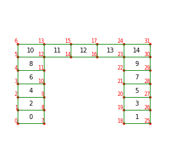

# Finite Element Modal Analysis of a Two-Dimensional Bridge Structure

**Structural Dynamics · Finite Element Method · Eigenvalue Analysis · Computational Mechanics · Python**

An educational, source-level implementation of **two-dimensional structural modal analysis** in Python. The project reads a bridge-like finite-element model from CSV files, assembles global stiffness and mass matrices, applies displacement constraints, and solves a generalized eigenvalue problem to obtain natural angular frequencies and vibration mode shapes.

> **Numerical status:** This repository demonstrates a finite-element modal-analysis workflow, **not a validated predictive structural model**. The checked-in solver uses simplified element stiffness and mass expressions. Its eigenfrequencies require formulation corrections and benchmark verification before engineering interpretation. See [Numerical verification and known limitations](docs/VERIFICATION.md).

## Structural model

<p align="center">
  
</p>

The structural representation comprises two column regions joined by a horizontal beam region. Both in-plane displacement components are associated with every node.

| Property | Value in supplied model |
|---|---:|
| Nodes | 32 |
| Four-node quadrilateral elements | 15 |
| Degrees of freedom per node | 2 (in-plane translations) |
| Unconstrained degrees of freedom | 64 |
| Fixed nodes (0-based IDs) | 0, 7, 18, 25 |
| Young's modulus | 30 GPa |
| Density | 2,500 kg/m³ |
| Assumed thickness in script | 1 |

Geometry, element connectivity and material inputs are maintained in separate CSV files, allowing the model data to be inspected independently of the solver.

## Computational methodology

The undamped free-vibration equation is

$$
\mathbf M\ddot{\mathbf u}+\mathbf K\mathbf u=\mathbf 0.
$$

Assuming harmonic motion, $\mathbf u(t)=\boldsymbol\phi e^{i\omega t}$, leads to

$$
\boxed{\mathbf K\boldsymbol\phi_i=\omega_i^2\mathbf M\boldsymbol\phi_i},
\qquad f_i=\frac{\omega_i}{2\pi}.
$$

Here $\mathbf K$ and $\mathbf M$ are global stiffness and mass matrices, $\boldsymbol\phi_i$ is a vibration mode, and $\omega_i$ is an angular frequency in **rad/s**. The current script prints angular frequencies, not Hz.

The source implementation uses:

- **Element discretization:** four-node bilinear quadrilateral elements with eight displacement degrees of freedom.
- **Numerical integration:** $2\times2$ Gauss quadrature for the stiffness-like element matrix.
- **Global assembly:** element contributions assembled into 64-by-64 global matrices using CSV connectivity.
- **Boundary treatment:** constrained nodes modified in the assembled matrices (see limitations).
- **Eigenvalue solution:** `scipy.linalg.eigh(K_global, M_global)`.
- **Post-processing:** interactive Matplotlib plots of the first three scaled modes, superposed on the undeformed mesh.

**Important distinction:** The code currently assembles a simplified stiffness expression proportional to $E\mathbf B^T\mathbf B$ and a diagonal mass $\rho A t\mathbf I_8$. These are **not equivalent to a verified plane-stress/plane-strain element stiffness and a correctly normalized physical mass matrix**. The standard formulations and a proposed validation plan are documented in [Finite-element formulation](docs/FORMULATION.md) and [Verification](docs/VERIFICATION.md).

## Implementation workflow

```text
CSV model inputs
      |
      v
Read nodes, connectivity, geometry and material properties
      |
      v
Build element Jacobians, B matrices and element contributions
      |
      v
Assemble global stiffness and mass matrices
      |
      v
Apply fixed-node constraints and matrix checks
      |
      v
Solve K phi = omega^2 M phi with SciPy
      |
      v
Display the first three mode shapes and angular frequencies
```

## Input data and repository layout

```text
structural-fem-modal-analysis/
├── README.md
├── Final_code.py                       # Original research/learning solver
├── Bridge_Ele.png                       # Structural model illustration
├── node_details.csv                    # 32 nodal coordinates
├── element_connectivity.csv           # 15 quadrilateral elements
├── GeometryDetails.csv                # Per-element geometric data
├── reinforced_concrete_properties.csv # Material-property table
├── requirements.txt                   # Python package names (unpinned)
└── docs/
    ├── DEVELOPMENT_NOTES.md           # Archived original detailed README
    ├── FORMULATION.md                 # Mathematical formulation and code mapping
    ├── VERIFICATION.md                # Status, known issues and acceptance checks
    └── REPRODUCIBILITY.md             # Windows/Linux execution guide
```

The solver reads the following filenames **exactly**: `node_details.csv`, `element_connectivity.csv`, `GeometryDetails.csv`, and `reinforced_concrete_properties.csv`. Its current geometry and input handling assumes that node IDs can be used as pandas row indices.

## Getting started

Requirements: **Python 3**, **NumPy**, **pandas**, **SciPy** and **Matplotlib**. Package versions used for the original results were not pinned.

```bash
git clone https://github.com/KartikTandel30/structural-fem-modal-analysis.git
cd structural-fem-modal-analysis
python -m pip install -r requirements.txt
```

**Before running:** The current `Final_code.py` contains a machine-specific path:

```python
directory = "C:/Users/karti/OneDrive/Desktop/RJ&SC"
```

Update that line to point to the folder containing the CSVs on your computer, or use the portable `pathlib` replacement described in [Reproducibility](docs/REPRODUCIBILITY.md). After checking the path, run:

```bash
python Final_code.py
```

The script attempts to print three natural angular frequencies and opens interactive mode-shape plots. These outputs are **illustrative until the numerical formulation is corrected and quantitatively verified**.

## Numerical verification roadmap

| Check | Purpose | Status |
|---|---|---|
| Correct quadrilateral $\mathbf B$ matrix | Verify natural-to-physical derivative mapping | Needs correction/recheck |
| Plane-stress or plane-strain constitutive matrix | Establish mechanically consistent element stiffness | Not yet implemented |
| Consistent or properly lumped mass matrix | Verify physical element mass | Not yet implemented |
| Reduced free-DOF eigenproblem | Avoid constrained-DOF artificial eigenvalues | Not yet implemented |
| Eigenpair residual and mass orthogonality | Test solver output | Not demonstrated |
| Mesh and reference comparison | Validate natural frequencies and mode shapes | Not demonstrated |

See [Verification](docs/VERIFICATION.md) for specific tests and pass/fail criteria. Existing code checks matrix symmetry and positive definiteness, but these checks alone do not establish physical correctness.

## Engineering contribution

This project records a finite-element implementation built around CSV-driven model definition, isoparametric interpolation, numerical integration, global matrix assembly, constrained structural degrees of freedom, generalized eigenvalue analysis, and modal visualization. It illustrates the computational workflow while documenting the improvements needed to move toward validated CAE results.

## Documentation

- [Finite-element formulation and implementation mapping](docs/FORMULATION.md)
- [Numerical verification and known limitations](docs/VERIFICATION.md)
- [Reproducibility and execution](docs/REPRODUCIBILITY.md)
- [Original detailed development README](docs/DEVELOPMENT_NOTES.md)

## Project context

Developed as part of a computational mechanics / numerical simulation portfolio.

**Kartik Suresh Tandel**
M.Sc. Computational Materials Science
TU Bergakademie Freiberg
